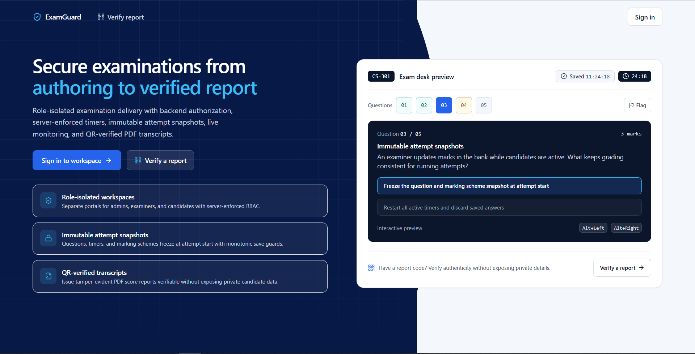
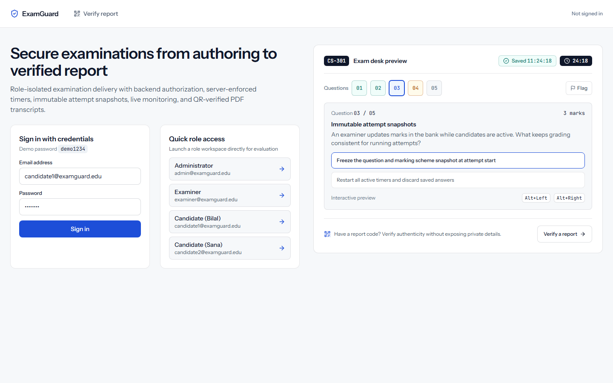

<div align="center">

# ExamGuard

**Role-isolated examination delivery, live monitoring, stratified paper generation, and QR-verified PDF transcripts.**

[](https://nextjs.org/)
[](https://www.typescriptlang.org/)
[](https://www.prisma.io/)
[](https://www.postgresql.org/)
[](https://tailwindcss.com/)

[Features](#walkthrough) · [Architecture](#architecture) · [Quick Start](#quick-start) · [Demo Credentials](#demo-credentials) · [Tests](#tests)

<br />



</div>

---

## Core Engineering Highlights

- **Stratified Paper Fairness** — `computeStratifiedQuotas` and `buildAttemptSnapshots` partition each exam pool into `easy`, `medium`, and `hard` strata using the largest-remainder method, then freeze each candidate's drawn questions, option order, and marks into `Attempt.itemsSnapshot` at launch.
- **Failure-Resilient Delivery** — Unsynced answer deltas persist in IndexedDB with a `localStorage` crash mirror (`lib/offlineQueue.ts`). Per-question monotonic revision numbers prevent out-of-order replays from overwriting newer server state. On disconnect, the exam workspace locks, hides the active question, and pauses the timer up to a server-enforced cap (`min(5 min, max(1 min, 25% of exam duration))`).
- **Tamper-Evident QR Transcripts** — `pdf-lib` and `qrcode` generate candidate transcripts and examiner summary PDFs on the server. Public verification (`/verify/[code]`) confirms official scores and timestamps while masking candidate names (`B**** A****`) and omitting emails and answers.

---

## Walkthrough

### Sign-In & Role Portal

Credential login with per-user salted `scrypt` password hashes, HMAC-SHA256 HTTP-only session cookies, login rate limiting, quick role-access cards for evaluation, and an interactive exam desk preview.



### Candidate Workspace

Groups enrolled exams into **Available now**, **Upcoming**, and **Completed**. Candidates launch active papers within server-enforced availability windows, inspect published score breakdowns, download PDF transcripts, and copy `EG-` verification codes.


### Timed Exam Delivery Runner

Built for focus under network instability and long sessions:
- **Question Navigator**: Visual states for answered (teal), review-flagged (amber), and current item, plus `Alt+Left` / `Alt+Right` keyboard navigation.
- **Workspace Controls**: Toggleable text and HTML5 canvas scratchpad persisted in `localStorage`, alongside saved font size (`sm`/`md`/`lg`), theme (`paper`/`dark`/`high-contrast`), and navigator side preferences.
- **Atomic Submission**: `finalizeAttemptAtomic` claims `status = in_progress` inside a database transaction so double-clicks or simultaneous expiry cannot double-submit.


### Examiner Control Center

Manages the full assessment lifecycle (`Draft` → `Published` → `Ongoing` → `Completed`) with live stratified `Easy / Medium / Hard` quotas:
- **Examination Sandbox**: Preview any exam at `/exam/[examId]?sandbox=1` with zero attempt records written.
- **Bulk Import**: Parse CSV (`papaparse`) and JSON files for questions and candidate enrollments with per-row validation errors.
- **Live Monitor & Outage Grace**: Track active heartbeats, broadcast announcements via Supabase Realtime (with automatic HTTP polling fallback), review non-conclusive incident signals (`tab_blur`, `offline_gap`, `reconnected`), and grant audited 1–30 minute grace extensions.
- **Grading & Analytics**: Auto-grade MCQs and partial-credit multi-select items, grade written answers against rubrics, and inspect summary metrics (mean, median, min, max, pass rate, SVG score distribution, and per-question distractor analytics).


### Administration Console

Create, edit, enable, or disable platform accounts, assign roles (`Administrator`, `Examiner`, `Candidate`), and inspect the persistent `AuditLog` stream.


### Public Report Verification

Zero-login verification at `/verify` and `/verify/[code]`. Blocks unpublished exams (`403`), masks candidate identity, and confirms the awarded score and submission timestamp.


---

## Architecture

ExamGuard runs as a single Next.js App Router codebase separating UI routes (`app/`), REST API handlers (`app/api/`), domain logic (`lib/`), and relational persistence (`prisma/schema.prisma`).

| Requirement Area | Implementation Files |
| --- | --- |
| Auth, RBAC, Audit | `lib/auth.ts`, `app/api/auth/*`, `app/api/admin/users/route.ts`, `app/admin/page.tsx` |
| Exam & Question Bank | `app/api/exams/route.ts`, `app/api/questions/route.ts`, `app/examiner/page.tsx` |
| Delivery, Offline Queue, Sync | `lib/offlineQueue.ts`, `app/api/exams/[id]/start/route.ts`, `app/api/attempts/[id]/*`, `app/exam/[examId]/page.tsx` |
| Stratified Fairness & Grading | `lib/grading.ts`, `app/api/grading/route.ts` |
| Monitoring & Outage Grace | `lib/realtime.ts`, `app/api/monitor/route.ts`, `app/api/attempts/[id]/grace/route.ts` |
| Bulk Import | `app/api/import/route.ts` |
| PDF Reports & QR Verification | `lib/pdf.ts`, `app/api/reports/*/pdf/route.ts`, `app/api/verify/[code]/route.ts`, `app/verify/*` |

<details>
<summary><strong>Design Decisions, Trade-offs &amp; Case Study Constraints</strong></summary>

1. **Fairness of Randomized Examinations**
   - Pure random sampling can hand one candidate mostly hard items and another mostly easy ones. `computeStratifiedQuotas` balances difficulty counts across candidates (`CS-301` draws `2E / 2M / 2H` from a `3E / 3M / 3H` pool).
   - *Trade-off*: Stratification balances difficulty counts, not mark totals, if questions within the same difficulty tier carry unequal marks. Examiners should keep mark weights consistent within each tier.

2. **Failure-Resilient Examinations**
   - Hiding the active question and locking navigation during disconnects removes the free-time exploit where a candidate goes offline to study a question without losing timer seconds, at the cost of requiring reconnection before continuing.
   - When the per-attempt auto-pause cap is exhausted, only an examiner or administrator can grant a bounded manual extension (`1–30` minutes) with a mandatory reason logged to both `Incident` and `AuditLog`.

3. **Mid-Exam Edits vs. Grading Consistency**
   - Editing or deleting a question in the bank never mutates running attempts because each attempt snapshots its questions, option order, marks, and answer key into `Attempt.itemsSnapshot` at launch.

4. **Monitoring Signals vs. Fair Conduct**
   - `tab_blur`, `offline_gap`, and `reconnected` events can stem from OS notifications or network drops. ExamGuard logs them as timestamped signals with an explicit non-conclusive disclaimer rather than auto-failing candidates.

</details>

---

## Tech Stack

| Layer | Technology | Purpose |
| --- | --- | --- |
| Framework | Next.js 15 (App Router), React 19, TypeScript | Co-located UI pages and typed REST API route handlers |
| Database | Prisma 6.4 + PostgreSQL (Supabase) | Relational integrity, unique constraints, transactional submission guards |
| Validation | Zod | Structured schema validation on every API route |
| Offline Sync | IndexedDB + `localStorage` | Browser-native answer delta persistence and crash recovery |
| Documents & Import | `pdf-lib`, `qrcode`, `papaparse` | Pure-JS server PDF transcripts, QR codes, and CSV parsing |
| Realtime | Supabase Realtime Broadcast + HTTP polling | Live examiner announcements and grace updates with automatic fallback |

---

## Quick Start

### Prerequisites

- Node.js 20+ and npm 10+
- PostgreSQL 15+ (tested on Supabase PostgreSQL with PgBouncer transaction pooling)

### Setup

1. **Install dependencies**
   ```bash
   cd examguard
   npm install
   ```

2. **Configure environment variables**
   ```bash
   cp .env.example .env
   ```
   Populate `.env`:
   - `DATABASE_URL` — Pooled PostgreSQL connection string (`port 6543`, `?pgbouncer=true` on Supabase)
   - `DIRECT_URL` — Direct PostgreSQL connection string (`port 5432`)
   - `AUTH_SECRET` — 32+ character HMAC secret for HTTP-only session cookies (required in production)
   - `NEXT_PUBLIC_SUPABASE_URL` and `NEXT_PUBLIC_SUPABASE_ANON_KEY` — Optional Supabase Realtime Broadcast credentials (HTTP polling runs automatically when omitted)

3. **Push schema and seed data**
   ```bash
   npm run db:push
   npm run db:seed
   ```

4. **Run locally**
   ```bash
   npm run dev
   ```
   Or build and start for production:
   ```bash
   npm run build
   npm start
   ```

---

## Demo Credentials

Shared password for all seeded accounts: `demo1234`

| Role | Email | Notes |
| --- | --- | --- |
| Administrator | `admin@examguard.edu` | Account management, roles, audit log |
| Examiner | `examiner@examguard.edu` | Exam authoring, sandbox, live monitor, grading |
| Candidate 1 (Bilal) | `candidate1@examguard.edu` | Enrolled in `CS-301`, `SE-402`, completed `DB-201` |
| Candidate 2 (Sana) | `candidate2@examguard.edu` | Enrolled candidate |
| Candidate 3 (Hamza) | `candidate3@examguard.edu` | Enrolled candidate |

Seeded public verification codes for `/verify`: `EG-DEMO2026`, `EG-SANA2026`.

---

## Tests

```bash
npm test
```

- `tests/unit.test.ts` — Unit tests for password hashing, HMAC session signing, RBAC helpers, Zod schemas, auto-grading, stratified difficulty quotas, analytics, and PDF sanitization.
- `tests/api.test.ts` — End-to-end API integration tests covering health, RBAC, admin user lifecycle, exam lifecycle, bulk import, sandbox isolation, revision conflict resolution, outage grace, manual grading, PDF generation, and public verification.
