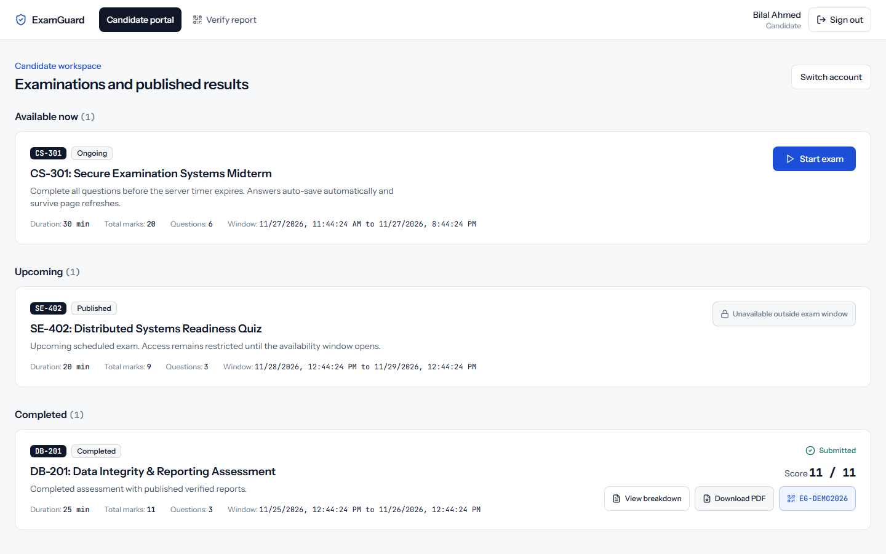
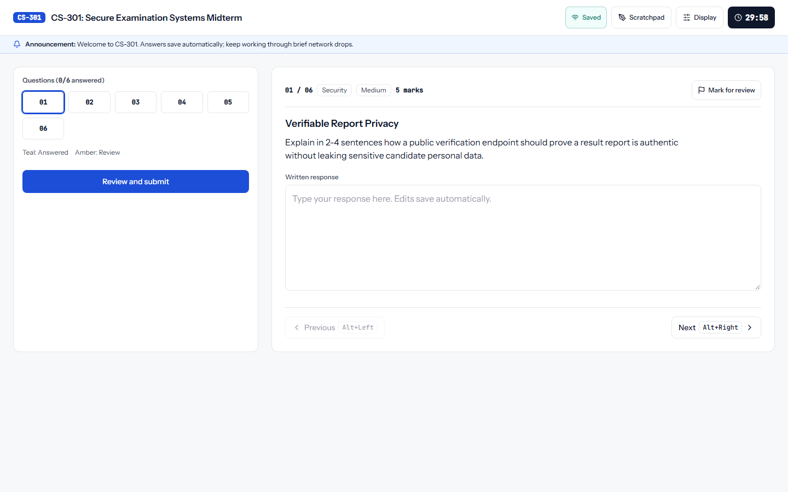

# ExamGuard: Secure Examination Management System

ExamGuard is a full-stack Next.js, Prisma, and PostgreSQL application for role-isolated examination delivery, live monitoring, automated and manual grading, and QR-verified PDF transcripts.

## Prerequisites

- Node.js 20+ and npm 10+
- PostgreSQL 15+ (tested on Supabase PostgreSQL with PgBouncer transaction pooling)

## Setup Instructions

1. **Install dependencies**:
   ```bash
   cd examguard
   npm install
   ```

2. **Configure environment variables**:
   Copy `.env.example` to `.env` and populate your database and auth credentials:
   ```bash
   cp .env.example .env
   ```
   - `DATABASE_URL`: Pooled PostgreSQL connection string (`port 6543`, `?pgbouncer=true` on Supabase)
   - `DIRECT_URL`: Direct PostgreSQL connection string (`port 5432`)
   - `AUTH_SECRET`: 32+ character HMAC secret for HTTP-only session cookies (required in production)
   - `NEXT_PUBLIC_SUPABASE_URL` and `NEXT_PUBLIC_SUPABASE_ANON_KEY`: Optional Supabase Realtime Broadcast credentials (HTTP polling runs automatically when omitted)

3. **Push schema and seed test data**:
   ```bash
   npm run db:push
   npm run db:seed
   ```

4. **Run locally or build for production**:
   ```bash
   npm run dev
   ```
   For a production build:
   ```bash
   npm run build
   npm start
   ```

## Deployment

Deploy `examguard/` to any Node-compatible host (such as Vercel, Render, or Railway) with `DATABASE_URL`, `DIRECT_URL`, and `AUTH_SECRET` configured in environment settings. Run `npm run db:push && npm run db:seed` against the target database before first launch.

## Test Credentials (All Roles)

Shared demo password: `demo1234`

- **Administrator**: `admin@examguard.edu`
- **Examiner**: `examiner@examguard.edu`
- **Candidate 1**: `candidate1@examguard.edu`
- **Candidate 2**: `candidate2@examguard.edu`
- **Candidate 3**: `candidate3@examguard.edu`

Seeded verification codes for `/verify`: `EG-DEMO2026`, `EG-SANA2026`.

## Implemented Modules

- **Core Requirements (3.1–3.8)**:
  - **3.1 Auth & RBAC**: Per-user salted `scrypt` password hashes, HMAC-SHA256 HTTP-only session cookies, login rate limiting, backend role and exam ownership enforcement, and admin account management with audit logging.
  - **3.2 Exam Management**: Draft, published, ongoing, and completed lifecycle transitions, availability windows, pre-publication review checklist, and exam editing.
  - **3.3 Question Bank**: Reusable bank with topic, difficulty, single-choice MCQ, multi-select (exact or partial credit), and rubric-backed written questions; question and option randomization with immutable per-attempt snapshots.
  - **3.4 Candidate Management**: Enrollment management, candidate portal grouped by Available, Upcoming, and Completed exams, and server-side eligibility and window guards.
  - **3.5 Examination Interface**: Accessible question workspace with answered, unanswered, and review-flagged states, keyboard shortcuts (`Alt+Left` / `Alt+Right`), debounced auto-save, refresh recovery, pre-submission review modal, and server-enforced deadline expiration.
  - **3.6 Live Monitoring**: Active attempts, answer progress, heartbeats, examiner announcements (Supabase Broadcast with polling fallback), and non-conclusive incident review banner.
  - **3.7 Grading**: Automatic objective grading (including partial-credit multi-select rules), manual written grading validated against question marks, consistent grading states (`pending`, `needs_manual`, `graded`), and pre-publish warning for ungraded scripts.
  - **3.8 Results & Analytics**: Controlled result publication, candidate-only score breakdown, exam summary metrics (mean, median, min, max, pass rate), and SVG score distribution chart.
- **Secondary Features (4.1–4.8)**:
  - **4.1 Network-Aware UI**: Live online/offline banner, unsynced queue counter, manual retry trigger, and exponential backoff sync.
  - **4.2 PDF Report Generation**: Access-controlled candidate result transcripts and examiner summary PDFs (`pdf-lib`, WinAnsi-safe text wrapping).
  - **4.3 Examination Sandbox**: Isolated examiner preview (`/exam/[examId]?sandbox=1`) that writes zero attempt records.
  - **4.4 Bulk Data Import**: CSV (`papaparse`) and JSON import for questions and candidate enrollments with per-row validation errors.
  - **4.5 Question Analytics**: Per-question attempt count, skip rate, average score, observed vs. configured difficulty, and most frequent distractor.
  - **4.6 Verifiable Reports**: Unique `EG-` verification codes, embedded QR codes in PDFs, and privacy-preserving public verification (`/verify/[code]`) that masks candidate names and omits emails and answers.
  - **4.7 Customizable Workspace**: Persisted font size (`sm`/`md`/`lg`), theme (`paper`/`dark`/`high-contrast`), navigator side (`left`/`right`), and compact navigator preferences.
  - **4.8 Digital Scratchpad**: Toggleable text notes and HTML5 drawing canvas persisted per attempt in `localStorage`.

## Open Innovation Challenges: Design Decisions & Trade-offs

### 5.2 Fairness of Randomized Examinations
- **Problem**: Pure random sampling from a mixed-difficulty pool can give one candidate mostly hard questions and another mostly easy ones.
- **Design**: `computeStratifiedQuotas` and `buildAttemptSnapshots` in `lib/grading.ts` partition the exam pool into `easy`, `medium`, and `hard` strata, assign proportional quotas using the largest-remainder method, shuffle within each stratum, and freeze the drawn paper into `Attempt.itemsSnapshot`.
- **Visibility**: The examiner portal surfaces live Easy/Medium/Hard quotas when creating, editing, listing, and pre-publish reviewing exams. Seeded exam `CS-301` draws 6 stratified questions (`2E / 2M / 2H`) from a 9-question (`3E / 3M / 3H`) pool.
- **Trade-off**: Stratification balances difficulty counts while preserving variation across candidates; it does not equalize total marks if questions inside the same difficulty tier carry unequal mark weights, so examiners should keep mark weights consistent within each tier.

### 5.3 Failure-Resilient Examinations
- **Problem**: Network drops, request timeouts, and power cuts cost candidates exam time and unsaved work, while naive client-side pauses let candidates gain free thinking time on questions or manufacture extra hours offline.
- **Design**:
  1. **Local-first persistence (`lib/offlineQueue.ts`)**: Unsynced answer deltas persist in IndexedDB with a synchronous `localStorage` crash mirror and replay automatically on reconnect.
  2. **Monotonic revision guard (`app/api/attempts/[id]/answer/route.ts`)**: Every answer edit increments a per-question revision integer. Out-of-order replays never overwrite newer server state; stale writes log a `sync_conflict` signal and return the winning server version.
  3. **Full workspace lock + server-bounded auto-pause (`app/exam/[examId]/page.tsx`, `app/api/attempts/[id]/heartbeat/route.ts`, `lib/grading.ts`)**: When `navigator.onLine` drops or a heartbeat/sync request times out, the workspace hides the active question, disables all inputs and question navigation, and pauses the visible timer. On reconnect, the server measures the gap from `lastHeartbeatAt` and extends `serverExpiresAt` up to a strict per-attempt cap (`min(5 min, max(1 min, 25% of exam duration))`), logging each event as an `offline_gap` `Incident`.
  4. **Audited examiner grace (`app/api/attempts/[id]/grace/route.ts`)**: Once the auto-pause cap is exhausted or an outage exceeds it, only an examiner or administrator can grant a bounded manual extension (1–30 minutes) with a mandatory reason, reopening auto-expired attempts while keeping submitted attempts permanently locked and writing both an `Incident` and `AuditLog` entry.
- **Trade-off**: Hiding the active question during disconnects removes the free-time exploit on both the current question and other questions, at the cost of requiring candidates to wait for reconnect before continuing.

## Case Study Analysis & Constraints

- **Mid-exam question edits vs. grading consistency**: Editing or deleting a question in the bank must not break active attempts. Every attempt snapshots its assigned questions, option order, marks, and answer key into `Attempt.itemsSnapshot` at launch.
- **Monitoring signals vs. fair conduct**: Tab switches (`tab_blur`), disconnects (`offline_gap`), and reconnections (`reconnected`) can result from OS notifications or network drops. The system records them as timestamped signals with an explicit non-conclusive disclaimer rather than auto-failing candidates.
- **Duplicate submission & race conditions**: A unique database constraint on `(exam_id, candidate_id)` prevents duplicate attempts, and `finalizeAttemptAtomic` claims `status = in_progress` inside a database transaction so double-clicks or simultaneous expiry cannot double-submit.
- **Privacy on public verification**: Public verification endpoints must confirm authenticity without leaking PII. `GET /api/verify/[code]` blocks unpublished exams (`403`), masks candidate names (`B**** A****`), and excludes email addresses and raw answers.

## Architecture & Database Design

ExamGuard uses a single Next.js App Router codebase with clear separation between UI pages (`app/`), REST API handlers (`app/api/`), domain logic (`lib/`), and relational persistence (`prisma/schema.prisma`).

- **Core Entities**: `User`, `Question`, `Exam`, `ExamQuestion`, `Enrollment`, `Attempt`, `Answer`, `Incident`, `Announcement`, `AuditLog`.
- **Key Relationships**: `Exam` links to `Question` via `ExamQuestion` and to candidates via `Enrollment` (unique on `(examId, candidateId)`). Each candidate gets at most one `Attempt` per exam (unique on `(examId, candidateId)`), containing `Answer` rows (unique on `(attemptId, questionId)`) and `Incident` events.
- **Design-to-Code Mapping**:
  | Requirement Area | Implementation Files |
  | --- | --- |
  | Auth, RBAC, Audit | `lib/auth.ts`, `app/api/auth/*`, `app/api/admin/users/route.ts`, `app/admin/page.tsx` |
  | Exam & Question Bank | `app/api/exams/route.ts`, `app/api/questions/route.ts`, `app/examiner/page.tsx` |
  | Delivery, Offline Queue, Sync | `lib/offlineQueue.ts`, `app/api/exams/[id]/start/route.ts`, `app/api/attempts/[id]/*`, `app/exam/[examId]/page.tsx` |
  | Stratified Fairness & Grading | `lib/grading.ts`, `app/api/grading/route.ts` |
  | Monitoring & Outage Grace | `lib/realtime.ts`, `app/api/monitor/route.ts`, `app/api/attempts/[id]/grace/route.ts` |
  | Bulk Import | `app/api/import/route.ts` |
  | PDF Reports & QR Verification | `lib/pdf.ts`, `app/api/reports/*/pdf/route.ts`, `app/api/verify/[code]/route.ts`, `app/verify/*` |

## Technology Selection

- **Next.js 15 (App Router) + TypeScript**: Co-locates frontend pages and server-side API route handlers with strict end-to-end typing.
- **Prisma + PostgreSQL (Supabase)**: Provides relational integrity, unique constraints, and transactional submission guards without paid third-party services.
- **Zod**: Enforces structured request validation on every API route.
- **IndexedDB + `localStorage`**: Delivers browser-native offline resilience with zero external dependencies.
- **`pdf-lib` + `qrcode` + `papaparse`**: Pure-JavaScript server PDF generation, QR embedding, and CSV parsing with no native binaries or headless browser overhead.
- **Supabase Realtime Broadcast + HTTP polling**: Pushes live announcements and outage grace updates immediately while degrading cleanly to polling if Realtime credentials are absent.

## Running Tests

```bash
npm test
```

- `tests/unit.test.ts`: Unit tests for password hashing, HMAC session signing, RBAC helpers, Zod schemas, auto-grading, stratified difficulty quotas, analytics, and PDF sanitization.
- `tests/api.test.ts`: End-to-end API integration tests covering health, RBAC, admin user lifecycle, exam lifecycle, bulk import, sandbox isolation, revision conflict resolution, outage grace, manual grading, PDF generation, and public verification.

## UI Screenshots

### Sign-In and Role Portal


### Candidate Workspace


### Timed Exam Delivery Runner


### Examiner Control Center


### Administration Console


### Public Report Verification


