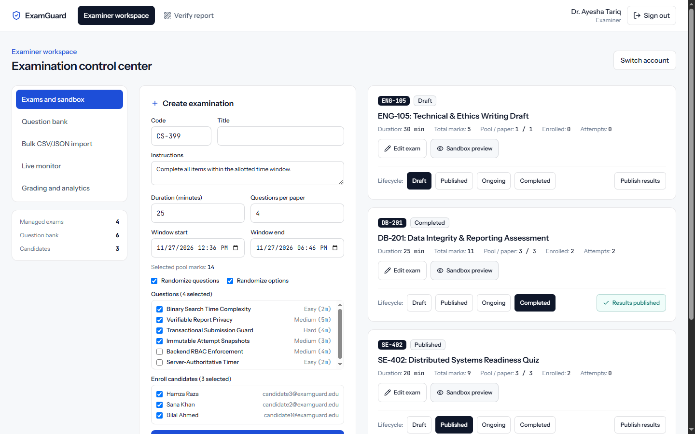
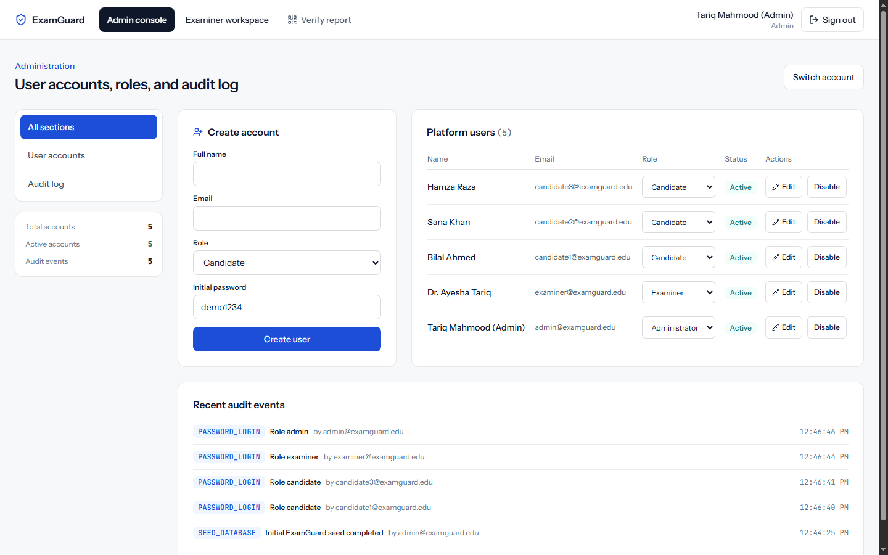
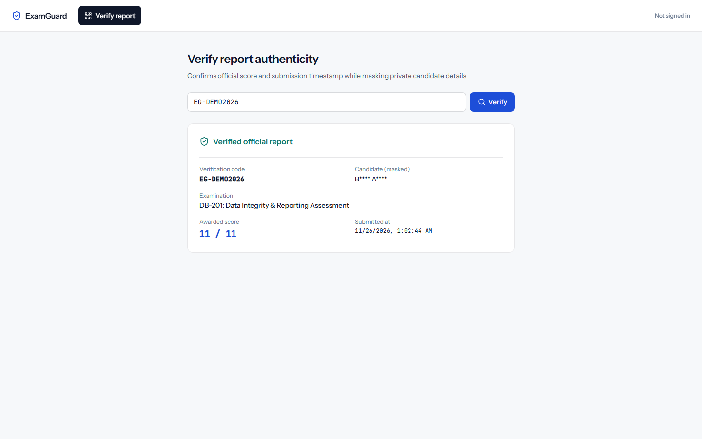

# ExamGuard: Secure Examination Management System

Full-stack Next.js, Prisma, and Supabase PostgreSQL application for role-isolated examination delivery, live monitoring, automated and manual grading, and QR-verified PDF transcripts.

## Setup Instructions

1. **Install dependencies**:
   ```bash
   cd examguard
   npm install
   ```

2. **Configure environment variables**:
   Copy `.env.example` to `.env` and set your PostgreSQL credentials:
   ```bash
   cp .env.example .env
   ```
   - `DATABASE_URL`: Pooled PostgreSQL connection string (`port 6543`, `?pgbouncer=true` on Supabase)
   - `DIRECT_URL`: Direct PostgreSQL connection string (`port 5432`)
   - `AUTH_SECRET`: 32+ character HMAC secret for HTTP-only session cookies
   - `NEXT_PUBLIC_SUPABASE_URL` and `NEXT_PUBLIC_SUPABASE_ANON_KEY`: Optional Supabase Realtime Broadcast credentials (polling fallback runs automatically)

3. **Push schema and seed test data**:
   ```bash
   npm run db:push
   npm run db:seed
   ```

4. **Run locally or build for production**:
   ```bash
   npm run dev
   ```

## Test Credentials (All Roles)

Shared demo password: `demo1234`

- **Administrator**: `admin@examguard.edu`
- **Examiner**: `examiner@examguard.edu`
- **Candidate 1**: `candidate1@examguard.edu`
- **Candidate 2**: `candidate2@examguard.edu`
- **Candidate 3**: `candidate3@examguard.edu`

## Implemented Modules

- **Core (3.1 to 3.8)**: Backend RBAC with per-user salted `scrypt` password hashes, exam lifecycle (`draft`, `published`, `ongoing`, `completed`), reusable question bank (create, edit, delete, MCQ/multi-select/written, randomization, rubrics), enrollment and window guards, auto-save and refresh recovery, live monitoring with non-conclusive disclaimers and announcements, auto/manual grading, and controlled result publication with breakdowns and exam summaries.
- **Secondary (4.1 to 4.8)**: Network-aware sync status with retry, WinAnsi-safe multi-page PDF report and exam summary exports (`pdf-lib`), isolated examiner sandbox, CSV/JSON bulk import with validation (`papaparse`), per-question difficulty analytics and SVG score distribution, QR-verifiable reports (`qrcode`), persisted workspace preferences, and persisted text/canvas digital scratchpad.
- **Innovation Module (Section 05)**:
  - **5.2 Fairness of Randomized Examinations**: Stratified difficulty-balanced paper builder in `lib/grading.ts` (`buildAttemptSnapshots`) draws proportional `easy`, `medium`, and `hard` slices from the exam pool so randomized papers maintain equal difficulty distribution.
  - **5.3 Failure-Resilient Examinations**: Local-first IndexedDB + `localStorage` offline delta queue (`lib/offlineQueue.ts`) with monotonic per-question revisions, server-authoritative deadline enforcement, and examiner-controlled verified outage grace (`POST /api/attempts/[id]/grace`).

## Running Tests

```bash
npm test
```

## UI Screenshots

### Sign-In and Role Portal


### Candidate Workspace


### Timed Exam Delivery Runner


### Examiner Control Center


### Administration Console


### Public Report Verification

